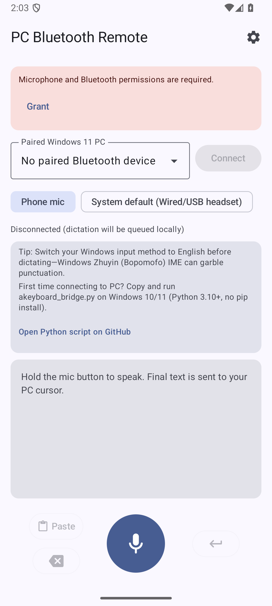

<div align="center">


# 🎙️ AKeyboard — Voice Keyboard for Android & Windows PC

**A mature, zero-backend Android voice-only keyboard (IME) and Windows 10/11 Bluetooth voice remote — built to work seamlessly with Google AI Studio (Gemini Live API) using your own API key.**

[-3DDC84?style=flat-square&logo=android&logoColor=white)](https://android.com)
[](https://github.com/Max97k/voice-keyboard-pc-bridge/releases/latest)
[-4285F4?style=flat-square&logo=google&logoColor=white)](https://aistudio.google.com/)
[](#-windows-1011-bluetooth-pc-dictation-built-for-office-work)
[](#-key-capabilities)
[](#-build--test)
[](https://max97k.github.io/voice-keyboard-pc-bridge/privacy.html)
[](LICENSE)

[English](README.md) • [繁體中文](README_zh.md) • [Releases](https://github.com/Max97k/voice-keyboard-pc-bridge/releases) • [Privacy Policy](https://max97k.github.io/voice-keyboard-pc-bridge/privacy.html) ([Markdown](PRIVACY.md)) • [Design Docs](docs/designs/akeyboard_voice_ime.md)

</div>

---

## 🎯 Why AKeyboard?

Most voice keyboards either lock you into paid subscriptions, route your audio through third-party servers, or only work on your phone. **AKeyboard** connects directly from your Android device to **Google AI Studio's Gemini Live API** using your personal API key (BYOK), and doubles as a **wireless AI dictation microphone for your Windows 10/11 PC**:

1. **On Android — Voice-Only System Keyboard + 2D Cursor Touchpad**: Hold to speak with real-time interim captions, instant punctuated commit on release, and slide anywhere else on the keyboard panel as a precision 2D touchpad.
2. **On Windows 10/11 — Direct PC Voice Typing for Office Productivity**: Dictate into Word, Outlook, Teams, Slack, Notion, browsers, or IDEs over Bluetooth RFCOMM—powered by a zero-dependency CPython 3.10+ bridge (`tools/akeyboard_bridge.py`) that requires **no `pip install`, no `.exe` installer, and no Windows admin rights**.

---

## 💻 Windows 10/11 Bluetooth PC Dictation (Built for Office Work)

<table>
<tr>
<td width="34%" align="center">

<br/>
<sub><em>In-app PC Bluetooth Remote screen</em></sub>
</td>
<td width="66%" valign="top">

Turn your phone (or wired/USB headset) into a dedicated wireless AI dictation remote for any Windows 10/11 workstation—including locked-down corporate laptops where AI endpoints or unsigned installers are restricted:

* **Zero Dependencies & Zero Admin Rights**: Uses only official Python 3.10+ standard library (`ctypes` + `Win32 SendInput` + `AF_BLUETOOTH`). Available in full ([`tools/akeyboard_bridge.py`](tools/akeyboard_bridge.py)) and single-screen compact ([`tools/akeyboard_bridge.min.py`](tools/akeyboard_bridge.min.py)) editions.
* **Unicode & CJK Ready**: Sends UTF-16 `KEYEVENTF_UNICODE` keystrokes directly to the active Windows cursor without garbling mixed Chinese/English punctuation.
* **Office Reliability Features**:
  * Local pending-send queue with one-tap **Resend** if Bluetooth drops or target focus is lost.
  * Last-3 sent transcript history with copy/re-send.
  * Remote **Backspace** & **Enter** buttons + quick **Paste** support.
  * Mic source selector (**Phone mic** vs. **Wired/USB headset**).
  * Clear diagnostics for UIPI (Admin/UAC windows) and missing focus ([`tools/ERROR_CODES.md`](tools/ERROR_CODES.md)).

</td>
</tr>
</table>

### Quick Start for Windows PC Dictation
1. Pair your Android phone and Windows 10/11 PC in system Bluetooth settings.
2. On Windows, switch your input method to **English** before dictating (to prevent Windows Zhuyin/IME from intercepting punctuation) and run:
   ```powershell
   python tools/akeyboard_bridge.py
   ```
3. On your phone, open **AKeyboard Settings → Open PC Bluetooth Voice Remote**, select your PC, tap **Connect**, and hold the mic button to dictate straight to your PC cursor.

*(Limitations: requires official CPython 3.10+ on Windows 10/11 with Bluetooth RFCOMM enabled; target window must have focus; Windows UIPI blocks standard-privilege `SendInput` into elevated Admin/UAC windows.)*

---

## 🤖 Google AI Studio Integration

AKeyboard is an independent open-source app designed to work directly with your **Google AI Studio** account and the **Gemini Live API** (`BidiGenerateContent` WebSocket):

* **Guided API Key Setup & Hardware Encryption**: Built-in link to Google AI Studio, clipboard paste, instant validation, and **Android Keystore (AES-256-GCM)** encrypted storage.
* **Dynamic Live Model Discovery**: Queries `models.list` (`bidiGenerateContent`) with your key so you can switch models dynamically (defaults to `gemini-3.5-transcribe-live` for low-latency streaming transcription).
* **Language & SMART Mode**: Supports `zh-TW` (default), `zh-TW + en-US`, Auto-detect (85+ languages), `zh-CN`, `en-US`, `ja-JP`, and `ko-KR`, plus `SMART` filler-word/repetition removal vs. `VERBATIM` mode.
* **Daily × Per-Model API Usage Dashboard**: Tracks Today, Last 30 Days, and All-Time token usage locally in Typed JSON DataStore (`90`-day daily retention + all-time totals), recording official `usageMetadata` when provided and clearly labeled estimated counts (`~` / `Est.`) for transcription-only models that omit server `usageMetadata`, with a direct link to check your billing & limits in AI Studio.

> [!IMPORTANT]
> **Regional Availability & Billing Notice**
> Because AKeyboard connects directly to **Google AI Studio (Gemini API)**, usage is subject to Google's regional rules:
> - **Unsupported Regions**: Not available in Mainland China, Hong Kong, Macau, Russia, and other restricted regions (including VPN traffic routed through those regions).
> - **EU / EEA / UK / Switzerland**: Google AI Studio's free tier is unavailable; a Google Cloud billing account is required.
> - Review Google's [official supported regions list](https://ai.google.dev/gemini-api/docs/available-regions) before setup.

---

## ✨ Key Capabilities

| Category | Details |
| :--- | :--- |
| 🎙️ **Streaming Voice IME** | 16 kHz 16-bit mono PCM over `wss://` (`OkHttp`), socket pre-warming (45 s idle TTL), 2 s cold-start ring buffer, and background socket draining so text commits with zero delay. |
| 👆 **2D Touchpad Cursor Control** | Slide anywhere outside the mic button to emit `DPAD` cursor steps with haptic feedback, configurable X/Y sensitivity (`8–48 dp`), multiline vertical guard, and `24 dp` edge dead zones for Android back gestures. |
| 🔐 **Autofill & Native Polish** | Android 11+ Inline Autofill suggestion strip (`androidx.autofill`), contextual IME action keys (`Search`, `Send`, `Next`, `Done`, `Return`), hold-to-repeat Backspace, Paste button, edge-to-edge IME nav bar, and Google Play Flexible In-App Updates. |
| 🌍 **10-Language Localization** | Full UI translations + Android Per-App Language support across English, Traditional Chinese, Simplified Chinese, Japanese, Korean, German, Spanish, French, Indonesian, and Portuguese (Brazil). |

---

## 🛡️ Privacy & Security by Design

* **Zero Developer Backend**: Audio streams strictly from your device to `generativelanguage.googleapis.com` over TLS (`wss://`) using your own API key. No audio is ever written to disk.
* **Hardware-Backed Key Storage**: API keys are encrypted via **Android Keystore (AES-256-GCM)** in Jetpack DataStore, excluded from cloud backup and device transfer (`allowBackup="false"`, `data_extraction_rules.xml`).
* **Password & Incognito Guard**: Automatically disables voice input in password fields and `IME_FLAG_NO_PERSONALIZED_LEARNING` contexts.
* **Prominent Disclosure & `FLAG_SECURE`**: First-run data disclosure before setup, `FLAG_SECURE` on `SettingsActivity`, and sanitized on-device diagnostics (never logs audio, typed text, or API keys).

---

## 🏗️ Architecture

```text
Android InputConnection  <--->  AKeyboardImeService (Compose + Lifecycle + Inline Autofill)
                                  ├── KeyboardScreen & TouchpadSurface (2D DPAD)
                                  ├── VoiceDictationSession & AudioCaptureManager (16 kHz PCM)
                                  └── GeminiLiveClient (OkHttp WSS BidiGenerateContent + Draining)
                                        └── ApiKeyStore (Keystore AES-GCM), SettingsRepository, UsageRepository (JSON DataStore)

RemoteDictationActivity  <--->  RemoteDictationViewModel
                                  ├── VoiceDictationSession & GeminiLiveClient
                                  └── BluetoothBridgeClient (RFCOMM SPP) ---> Windows PC (tools/akeyboard_bridge.py)
```

---

## 🚀 Build & Test

### Prerequisites
* Android 12 (API 31) or higher (`compileSdk 37` / `targetSdk 37`)
* A Google AI Studio API key (for live voice testing)

### Commands
```bash
# Run Android JVM unit tests (66 tests)
./gradlew :app:testDebugUnitTest

# Run strict Android Lint (warningsAsErrors = true)
./gradlew :app:lintDebug

# Run Windows Python bridge unit tests
python -m unittest discover -s tools -p "test_*.py"

# Run full headless emulator + Maestro E2E suite (5 flows)
powershell -NoProfile -ExecutionPolicy Bypass -File .agents/scripts/run_maestro_e2e.ps1
```

---

## 📄 License

Distributed under the MIT License. See [LICENSE](LICENSE) for details.
