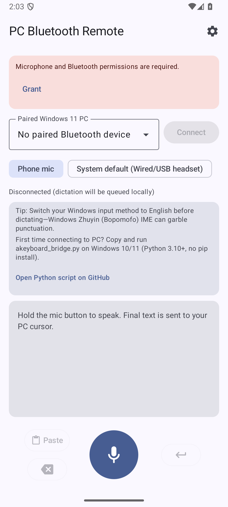

<div align="center">


# 🎙️ AKeyboard — Android 與 Windows 電腦雙端 AI 語音鍵盤

**一款成熟、無開發者後端的 Android 純語音輸入法（IME）與 Windows 10/11 藍牙語音遙控器 —— 採用自帶金鑰（BYOK）架構，深度整合 Google AI Studio（Gemini Live API）。**

[-3DDC84?style=flat-square&logo=android&logoColor=white)](https://android.com)
[](https://github.com/Max97k/voice-keyboard-pc-bridge/releases/latest)
[-4285F4?style=flat-square&logo=google&logoColor=white)](https://aistudio.google.com/)
[](#-windows-1011-藍牙語音遙控輸入辦公首選)
[](#-核心功能一覽)
[](#-建置與測試)
[](https://max97k.github.io/voice-keyboard-pc-bridge/privacy.html)
[](LICENSE)

[English](README.md) • [繁體中文](README_zh.md) • [版本發行紀錄](https://github.com/Max97k/voice-keyboard-pc-bridge/releases) • [隱私權政策](https://max97k.github.io/voice-keyboard-pc-bridge/privacy.html) ([Markdown](PRIVACY.md)) • [設計文件](docs/designs/akeyboard_voice_ime.md)

</div>

---

## 🎯 為什麼選擇 AKeyboard？

市面上多數語音輸入法要嘛綁定高價訂閱、要嘛把你的語音傳進第三方開發者伺服器，而且通常只能在手機上使用。**AKeyboard** 直接用你自己的 API Key 直連 **Google AI Studio 的 Gemini Live API**，並同時提供「**手機輸入法**」與「**Windows 電腦無線語音遙控**」兩種工作流：

1. **在 Android 手機上 — 純語音鍵盤 ＋ 2D 游標觸控板**：按住說話即時串流預覽、放開立刻標點上屏；鍵盤其餘面積全部化為精密的 2D 游標觸控板。
2. **在 Windows 10/11 電腦上 — 辦公專用的藍牙語音輸入器**：透過藍牙把手機變成電腦的無線 AI 麥克風，直接把繁體中文與中英混輸文字打進 Word、Outlook、Teams、Slack、Notion 或 IDE —— 電腦端採用零依賴的 CPython 3.10+ 腳本（`tools/akeyboard_bridge.py`），**免 `pip install`、免安裝 `.exe`、免系統管理員權限**。

---

## 💻 Windows 10/11 藍牙語音遙控輸入（辦公首選）

<table>
<tr>
<td width="34%" align="center">

<br/>
<sub><em>App 內「電腦藍牙語音遙控」操作畫面</em></sub>
</td>
<td width="66%" valign="top">

將你的手機（或有線／USB 耳麥）瞬間變成 Windows 10/11 電腦的無線 AI 語音輸入法，就算在禁止安裝軟體或封鎖外部 AI 網站的公司電腦上也能流暢使用：

* **零依賴、免管理員權限**：完全使用官方 Python 3.10+ 內建標準函式庫（`ctypes` + `Win32 SendInput` + `AF_BLUETOOTH`），提供完整版（[`tools/akeyboard_bridge.py`](tools/akeyboard_bridge.py)）與單畫面精簡版（[`tools/akeyboard_bridge.min.py`](tools/akeyboard_bridge.min.py)）。
* **繁中與 Unicode 完美上字**：直接送出 UTF-16 `KEYEVENTF_UNICODE` 事件到 Windows 游標位置，中英混雜與全形標點不亂碼。
* **專為辦公情境打磨的可靠性**：
  * 斷線或未聚焦時自動於本機暫存，支援一鍵 **重送（Resend）**。
  * 保留最近 3 筆已送出紀錄，隨時重送或複製。
  * 內建遠端 **退格刪除（Backspace）**、**Enter 送出** 與 **貼上** 按鈕。
  * 支援切換 **手機內建麥克風** 或 **外接有線／USB 耳麥**。
  * 針對 UIPI（管理員／UAC 視窗）與焦點遺失提供明確錯誤提示與代碼對照（[`tools/ERROR_CODES.md`](tools/ERROR_CODES.md)）。

</td>
</tr>
</table>

### Windows 電腦端快速開始
1. 在系統藍牙設定中完成手機與 Windows 10/11 電腦的配對。
2. 使用前請先將 Windows 輸入法切換為 **英文**（避免 Windows 注音輸入法攔截標點符號），並於電腦執行：
   ```powershell
   python tools/akeyboard_bridge.py
   ```
3. 在手機打開 **AKeyboard 設定 → 開啟電腦藍牙語音遙控輸入**，選擇電腦點擊 **連線**，按住麥克風說話即可直接輸入到電腦游標處。

*（限制：電腦端需使用支援藍牙 Socket 的官方 CPython 3.10+、群組原則須允許藍牙 RFCOMM；目標視窗須處於焦點狀態，且一般權限腳本受 Windows UIPI 保護無法直接輸入到系統管理員／UAC 提權視窗。）*

---

## 🤖 Google AI Studio 深度整合

**AKeyboard** 是完全獨立的開源應用程式，透過你個人的 **Google AI Studio** 金鑰直連 **Gemini Live API**（`BidiGenerateContent` WebSocket）：

* **引導式金鑰設定與硬體加密**：設定頁提供 Google AI Studio 一鍵前往、剪貼簿貼上、即時驗證，並使用 **Android Keystore（AES-256-GCM）** 加密儲存金鑰。
* **動態探索可用模型**：驗證金鑰後自動查詢 `models.list`（`bidiGenerateContent`）列出帳號可用模型並隨時切換（預設採用低延遲串流轉寫模型 `gemini-3.5-transcribe-live`）。
* **多語言與智慧轉錄模式**：支援繁體中文（預設 `zh-TW`）、中英混輸（`zh-TW + en-US`）、自動偵測 85+ 語言、簡體中文、英文、日文與韓文，並可切換 `SMART`（自動濾除「呃、那個」等贅詞與重複）或 `VERBATIM` 逐字模式。
* **每日 × 分模型 API 用量統計面板**：使用 Typed JSON DataStore 在本機記錄「今日 / 近 30 天 / 累計」Token 用量與請求次數（保留 90 天每日明細與完整總帳），支援官方 `usageMetadata` 與未回報模型的估算補齊（UI 明確標示 `~`／`含估算`），並附上一鍵前往 AI Studio 查看帳單與限額的捷徑。

> [!IMPORTANT]
> **地區可用性與計費限制提醒**
> AKeyboard 僅直連 **Google AI Studio（Gemini API）**，使用權限受 Google 官方地區規範限制：
> - **不支援地區**：中國大陸、香港、澳門、俄羅斯等地區無法使用（若於支援地區但使用上述地區之 VPN 節點亦會遭阻擋）。
> - **歐盟 / EEA / 英國 / 瑞士**：依當地法規不提供免費額度（Free Tier），須於 Google Cloud 綁定計費帳號後方可使用。
> - 設定前請先確認 [Google 官方支援地區名單](https://ai.google.dev/gemini-api/docs/available-regions)。

---

## ✨ 核心功能一覽

| 類別 | 細節說明 |
| :--- | :--- |
| 🎙️ **即時串流語音輸入法** | 以 `OkHttp` `wss://` 串流 16 kHz 16-bit 單聲道 PCM，支援開蓋預熱連線（45 秒閒置 TTL）、冷啟動 2 秒環形音訊緩衝、以及背景收尾（draining）確保零延遲上屏同時完整記帳。 |
| 👆 **2D 觸控板游標控制** | 在非麥克風區域滑動即可發送 `DPAD` 方向鍵移動游標，支援震動回饋、水平／垂直步長靈敏度微調（`8–48 dp`）、多行上下保護與左右 `24 dp` 防側滑返回死區。 |
| 🔐 **系統級整合與細節手感** | 支援 Android 11+ Inline Autofill 密碼管理器建議列、語意動作鍵（搜尋／送出／下一步／完成／換行）、長按退格連續刪除、剪貼簿貼上按鈕、Edge-to-Edge 自適應透明導覽列，以及 Google Play 應用程式內彈性更新。 |
| 🌍 **10 國語言完整在地化** | 支援繁體中文、英文、簡體中文、日文、韓文、德文、西班牙文、法文、印尼文與巴西葡萄牙文，並支援 Android 系統「各應用程式語言（Per-App Language）」。 |

---

## 🛡️ 隱私與安全設計

* **零開發者後端**：音訊僅於按住錄音時經加密通道（`wss://`）直連 `generativelanguage.googleapis.com`，本機絕不寫入任何錄音檔。
* **硬體級金鑰保護**：API Key 經 **Android Keystore（AES-256-GCM）** 加密存入 Jetpack DataStore，並關閉雲端備份與換機遷移（`allowBackup="false"`、`data_extraction_rules.xml`）。
* **密碼與隱私欄位防護**：偵測到密碼欄或 `IME_FLAG_NO_PERSONALIZED_LEARNING` 時自動停用麥克風。
* **顯著揭露與防截圖**：首次使用前強制展示資料揭露聲明，設定頁啟用 `FLAG_SECURE` 防止金鑰外洩，診斷報告亦經脫敏處理（絕不含語音、輸入文字或 API Key）。

---

## 🏗️ 系統架構

```text
Android InputConnection  <--->  AKeyboardImeService (Compose + Lifecycle + Inline Autofill)
                                  ├── KeyboardScreen & TouchpadSurface (2D DPAD)
                                  ├── VoiceDictationSession & AudioCaptureManager (16 kHz PCM)
                                  └── GeminiLiveClient (OkHttp WSS BidiGenerateContent + Draining)
                                        └── ApiKeyStore (Keystore AES-GCM), SettingsRepository, UsageRepository (JSON DataStore)

RemoteDictationActivity  <--->  RemoteDictationViewModel
                                  ├── VoiceDictationSession & GeminiLiveClient
                                  └── BluetoothBridgeClient (RFCOMM SPP) ---> Windows PC (tools/akeyboard_bridge.py)
```

---

## 🚀 建置與測試

### 環境需求
* Android 12（API 31）以上（`compileSdk 37` / `targetSdk 37`）
* Google AI Studio API Key（實際語音連線測試用）

### 常用指令
```bash
# 執行 Android JVM 單元測試（66 項測試）
./gradlew :app:testDebugUnitTest

# 執行嚴格 Lint 檢查（warningsAsErrors = true）
./gradlew :app:lintDebug

# 執行 Windows Python 橋接腳本與發佈工具單元測試
python -m unittest discover -s tools -p "test_*.py"

# 執行無頭模擬器 + Maestro E2E 全流程驗證（5 支腳本）
powershell -NoProfile -ExecutionPolicy Bypass -File .agents/scripts/run_maestro_e2e.ps1
```

---

## 📄 授權條款

採用 Apache License 2.0 授權條款，詳見 [LICENSE](LICENSE)。
